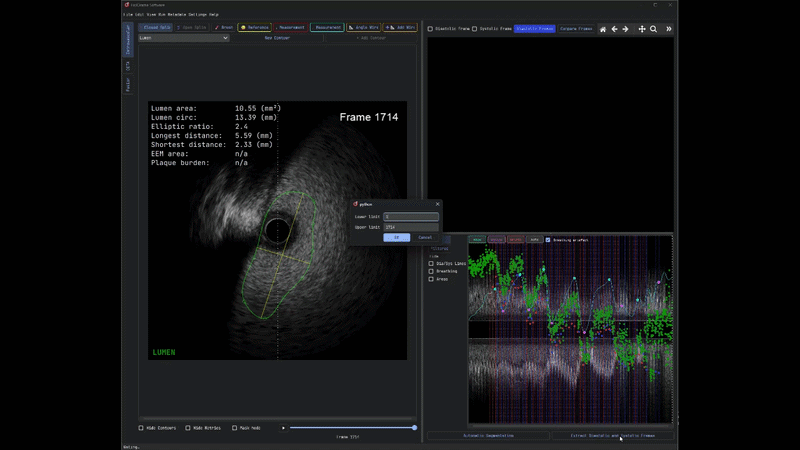
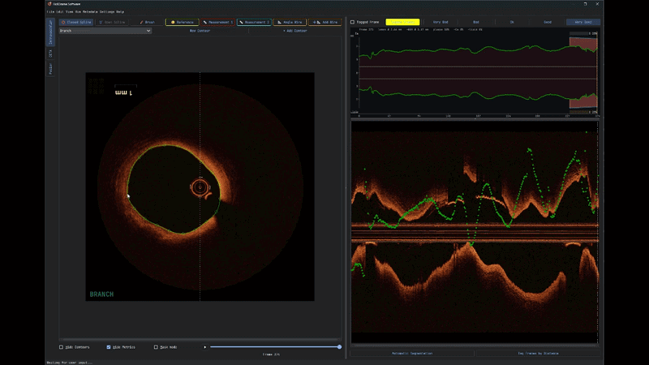
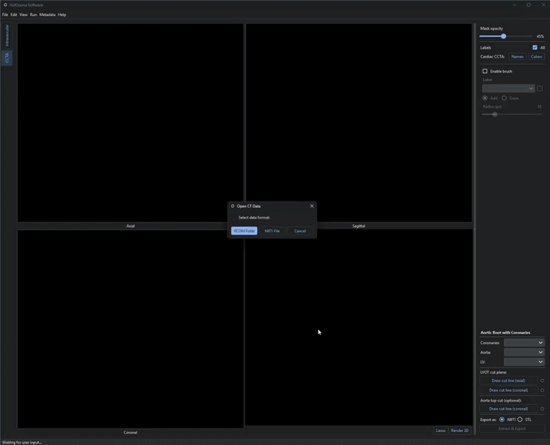
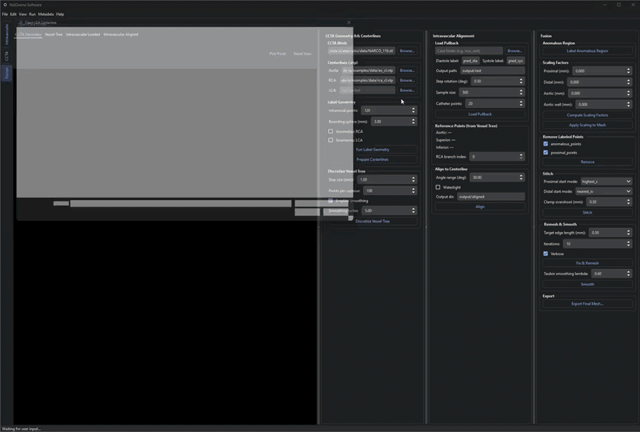
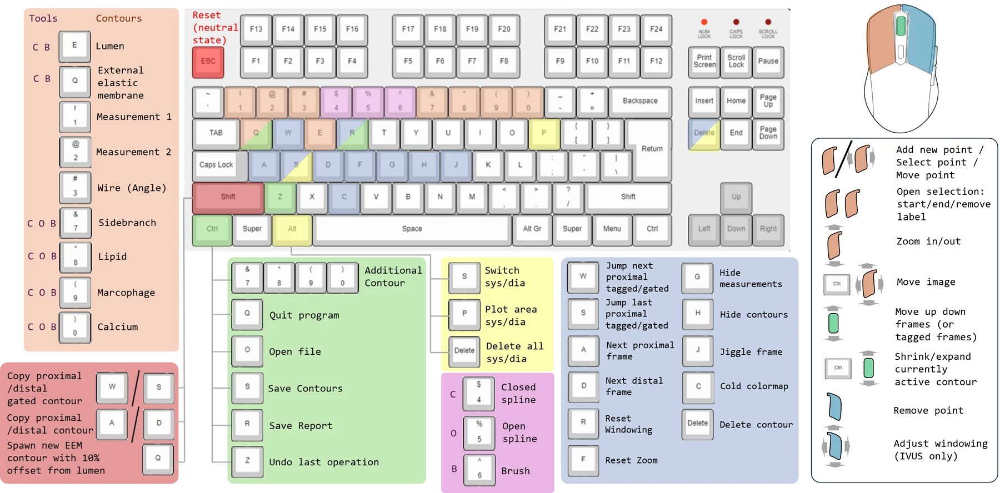

<p align="center">
  <a href="https://github.com/AI-in-Cardiovascular-Medicine/HolOrama.jpg">
    
  </a>
</p>


# HolOrama: A unified platform for cardiac image analysis <!-- omit in toc -->
[](https://github.com/AI-in-Cardiovascular-Medicine/HolOrama/tags)
[](LICENSE)
[](https://holorama.readthedocs.io/en/latest/)
[](https://doi.org/10.1016/j.cmpb.2025.109065)

<figure class="epigraph" style="text-align: center; font-style: italic;">
  <blockquote>
    "A mixture from greek 'Holo' meaning full and 'Orama' meaning vision. Together building the promise of this GUI application to visualize the whole heart from different modalities, and by fusing them creating a full vision of the heart."
  </blockquote>
</figure>

Currently spans:
- Quantification of Intravascular Ultrasound (IVUS) and Optical Coherence Tomography (OCT)
- Quantification of Coronary Computed Tomography Angiography (CCTA)
- Fusion of IVUS/OCT with CCTA

# Demo
<p align="left">
  Segment, modify and analyze IVUS images, inclusive with gating functionalities:<br>
  
</p>

<p align="left">
  Also spans to OCT images, address uncertainty systematically:<br>
  
</p>

<p align="left">
  Segment and visualize CCTA data in 3D, remove outliers with intuitiv tools:<br>
  
</p>

<p align="left">
  Fuse CCTA and intravascular data into one single geometry:<br>
  
</p>

## Table of contents <!-- omit in toc -->

- [Installation](#installation)
- [Basic](#basic)
- [Functionalities](#functionalities)
- [Configuration](#configuration)
- [Usage](#usage)
- [Keyboard shortcuts](#keyboard-shortcuts)
- [Acknowledgements](#acknowledgements)

## Installation

### Pre-built Windows installer (recommended for most users)

If you just want to run the app — no Python, no coding — download the latest **`HolOrama-Setup-<version>.exe`** from the [**Releases**](https://github.com/AI-in-Cardiovascular-Medicine/HolOrama/releases/latest) page and run it. It installs per-user (no administrator rights), adds Start-Menu and Desktop shortcuts, and includes everything, automatic segmentation too — logs and settings live in `%LOCALAPPDATA%\HolOrama`, while your analysis outputs are saved next to the files you open.

> On first launch Windows may show a **"Windows protected your PC"** (SmartScreen) prompt because the installer isn't code-signed — click **More info → Run anyway**.

The only optional component is **vmtk** for *Calculate Centerlines* (CCTA): the app offers to download it into its own environment the first time you use that button (~1.5 GB, once).

### From source

Dependencies are managed with [uv](https://docs.astral.sh/uv/) and pinned in `uv.lock`; the install scripts install uv if needed and run `uv sync`. Python 3.11–3.13 on Windows, Linux and macOS.

```bash
# Linux / macOS
bash install.sh
# Windows (PowerShell; install the Visual C++ Redistributable 2022 x64 first if missing)
.\install.ps1
```

| Flag (`install.sh` / `install.ps1`) | Effect |
|---|---|
| `--dev` / `-Dev` | Also install dev + docs dependencies (tests, linters, Nuitka, Sphinx) and the pre-commit hooks |
| `--gpu` / `-Gpu` | CUDA instead of the default runtime for automatic segmentation (NVIDIA; CUDA 12 + cuDNN as pip wheels, driver ≥ 527.41). Mainly for Linux: on Windows the default DirectML runtime already uses the GPU |
| `--no-segmentation` / `-NoSegmentation` | Skip the optional `segmentation` extra (onnxruntime) |
| `--centerlines` / `-Centerlines` | Set up the vmtk environment for *Calculate Centerlines* now instead of on first use |

Without the scripts: `uv sync --extra segmentation` (or `--extra segmentation-gpu`; add `--group dev --group docs` for development). Run the app with `uv run src/main.py`.

**How the optional parts work**
- **Automatic segmentation**: the nnU-Net IVUS lumen model is bundled as a 5 MB ONNX file and runs with onnxruntime — no PyTorch. On Windows (installer and source) it uses any DirectX 12 GPU through DirectML (≈0.2 s per frame, no CUDA install) and falls back to the CPU (a few seconds per frame); on Linux `--gpu` adds CUDA for NVIDIA GPUs (see `segmentation` in `config.yaml`). `scripts/model_export/` holds the one-off export from the nnU-Net checkpoint.
- **Centerlines (vmtk)**: vmtk only exists on conda-forge, so it runs in a separate, pinned [pixi](https://pixi.sh) environment (`src/pages/ccta/left_half/cut_geometry/vmtk_env/`) that HolOrama creates on first use — natively, no WSL. Windows x64, Linux x64 and Intel macOS.

See the [installation docs](https://holorama.readthedocs.io/en/latest/contents/installation.html) for details and for building the Windows installer yourself.

## Functionalities

This application is designed for IVUS, OCT and CCTA images in DICOM or NIfTi format and offers the following functionalities:

### IVUS / OCT

- Inspect IVUS/OCT images frame-by-frame and display DICOM metadata
- Manually **draw one or several contours** (lumen, eem, calcium, side branch, macrophage, lipid) with automatic calculation of several measurements
- Either draw closed spline, open spline or a closed spline with an uncertain region indicated by start- and end point
- **Automatic segmentation** of (currently only IVUS) lumen for all frames
- **Automatic gating** with extraction of diastolic/systolic frames if in IVUS mode
- Manually tag diastolic/systolic frames
- Longitudinal view: toggle visibility of the diastolic/systolic marker lines, breathing curve, and area dots independently
- **Breathing motion** is detected automatically from the lumen area signal and can be reviewed/corrected by hand, then used to reorder gated frames into a breathing-corrected pullback
- Ability to measure up to two distances per frame which will be stored in the report
- Indicate one or several wire shadows and blood artefacts per frame, each as an angular sector that can be opened past 180°, reopened and dragged
- Create automatic masks from contour with predefined rulesets
- Copy/paste contours from neighbouring, gated or tagged frames
- **Auto-save** of contours and tags enabled by default with user-definable interval
- Generation of report file containing detailed metrics for each frame
- Save coordinate data as csv files
- Ability to save images and segmentations as **NIfTi files**, e.g. to train a machine learning model

### CCTA

- Read CT volumes from a **DICOM folder** or a **NIfTi file** and view them as synchronized axial, coronal and sagittal slices
- Load an existing segmentation mask (NIfTi) or start from a blank, multi-label mask
- **Brush tool** to manually add or erase mask labels on any of the 2D views, with adjustable radius and per-label color
- **3D volume rendering** of all visible mask labels (surface extraction via VTK)
- **Lasso tool** in the 3D render to draw a closed region and delete the voxels of a chosen label that fall inside it
- Toggle label visibility/color and rename labels, synced across the 2D views, brush tool and 3D render
- Draw cut lines on the axial/coronal views to define the LVOT and aortic root, then extract the coronaries/aorta/LV as a combined **NIfTi mask** or **STL mesh**
- **Auto-save** of the mask enabled by default with user-definable interval, with versioned mask files and auto-reload of the latest mask on reopening a volume

### Fusion (IVUS/OCT + CCTA)

- Load the CCTA mesh and the aorta, RCA and LCA centerlines (`.vtp`), and fix the branch structure by **splitting and merging** centerline branches
- **Label the geometry** into aorta, RCA, LCA and their branches, correct mislabelled vertices with a **lasso**, and **rename or delete side branches** (the ostium is closed with a patch on the parent wall)
- **Discretize the vessel tree** into cross-sections with reference points at every ostium and bifurcation
- **Align** an IVUS or OCT pullback onto any coronary branch automatically, or manually for elliptic anomalous vessels
- **Scale** the CCTA to the intravascular calibre, replace the overlapping segment and **stitch** the two into one surface, reconnecting side branches that leave it
- **Remesh and smooth** the result, also locally with a sphere brush
- **Cut inlets and outlets** flat at any slice of the vessel tree, capped and ready for CFD, and export the cut mesh, every cap and the cut centerlines
- **Saved state**: labels, branch edits, the alignment and the scaling factors are saved next to the mesh on every change and restored in one go when the mesh is opened again

## Configuration

Make sure to quickly check the **src/config.yaml** file and configure everything to your needs.

**Display**:
- contour_preset: Name of the contour preset defining the intravascular contour types; edited in Settings → Intravascular Contour Settings.
- image_size: In pixels, creates the quadratic box displaying the IVUS/OCT images. Default 800x800 px.
- gating_display_stretch: input parameter for .setStretchFactor in class RightHalf
- lview_display_stretch: input parameter for .setStretchFactor in class RightHalf
- windowing_sensitivity: How much windowing (level/width) changes per pixel dragged with <kbd>RMB</kbd>. 1 is default, below 1 slower, above 1 faster.
- zoom_sensitivity: Fraction of zoom applied per pixel dragged. Below 0.005 for slower, above for faster.
- n_interactive_points: The draggable points on the contour (lumen); calcium, lipid, macrophage and branch contours default to half of this. New points can also be added interactively by clicking on the contour.
- n_points_contour: Number of points used to represent the interpolated contour outline. Ideally a multiple of 100 (used when calculating closest points).
- contour_thickness / point_thickness / point_radius: Line and knot-point drawing sizes for contours.
- color_start_point / color_end_point: Colors of the start/end markers. Accepts any of the 20 predefined PyQt colors or a hex code (see [Qt colors](https://doc.qt.io/qt-6/qcolor.html)). Each contour type's own color is set in its contour preset (`src/presets/intravascular`).
- angle_handle_radius_mm: How far from the image centre the handles and arc of an angular sector (wire shadow, blood) are drawn. Only their direction carries meaning, so this is purely where they are shown; clamped to stay inside the image.
- alpha_contour: Contour fill transparency, 0-255 (higher is more opaque).

**Gating**:
- normalize_step: If step=0, compute one global z-score over the entire data. If step > 0, split data into non-overlapping windows of length normalize_step and apply z-score to each window separately.
- f_cardiac_min / f_cardiac_max: Heart-rate search range in Hz for the cardiac frequency detection, covering rest (~45 BPM) to stress (~200 BPM).
- bandpass_lo_frac: Lower bandpass cutoff as a fraction of the detected cardiac frequency; removes slow pullback trend (sub-cardiac drift).
- bandpass_hi_frac: Upper bandpass cutoff as a fraction of the detected cardiac frequency; passes the 2nd harmonic while removing speckle noise.

**Report**:
- plot: Whether to display a plot of the gated-frame results after report generation.
- save_as_csv: Whether to additionally save contour coordinate data as csv files.

**Save**:
- autosave_interval: Auto-save interval in ms for contours/tags (IVUS/OCT) and the mask (CCTA).
- save_2d: Whether to additionally save each frame's image/mask as an individual NIfTi file.
- save_3d: Whether to save the full stack of frames as a single 3D NIfTi volume.

**Centerlines** (Calculate Centerlines, CCTA):
- env_dir: Where the pixi-managed vmtk environment is installed; empty = `vmtk-env` in the per-user data directory.
- pixi_path: A pixi executable to use; empty = pixi on PATH, else the copy HolOrama downloads.

**Segmentation**:
- device: `auto` (the first working GPU backend: CUDA with the segmentation-gpu extra, then DirectML on Windows; else CPU), `cuda` / `directml` (that GPU or refuse) or `cpu`.
- precision: GPU only (the CPU runs fp32). `auto` = fp16 when it is clearly faster on this GPU, else fp32; `fp16` = the model's `_fp16.onnx` copy (~1.3-1.5x faster, a few border pixels per frame differ); `fp32` = full precision.
- model_file: Empty = the bundled ONNX model; otherwise a `.onnx` exported with `scripts/model_export/export_onnx.py`.
- use_mirroring: nnU-Net's test-time mirroring; ~4x slower, noticeably better masks.
- tile_step_size: Sliding-window overlap as a fraction of the patch size (nnU-Net default 0.5).
- batch_size: Tiles per network call (2 = one 512x512 frame); larger is not faster on a CPU and can exhaust a 6-8 GB GPU.
- num_threads: CPU threads for inference; 0 = all cores.
## Usage

After the config file is set up properly, you can run the application using:

```bash
uv run src/main.py
```

This will open a graphical user interface (GUI) in which you have access to the above-mentioned functionalities.

## Keyboard shortcuts
For ease-of-use, this application contains several keyboard shortcuts.\
In the current state, these cannot be changed by the user (at least not without changing the source code):

<p align="left">
  <br>
</p>

- Press <kbd>Ctrl</kbd> + <kbd>O</kbd> to open a DICOM/NIfTi file
- Use the <kbd>A</kbd> and <kbd>D</kbd> keys to move through the IVUS images frame-by-frame
- If gated (diastolic/systolic) frames are available, you can move through those using <kbd>S</kbd> and <kbd>W</kbd>\
  Make sure to select which gated frames you want to traverse using the corresponding button (blue for diastolic, red for systolic)
- Press <kbd>E</kbd> to manually draw a new lumen contour\
  In case you accidentally delete a contour, you can use <kbd>Ctrl</kbd> + <kbd>Z</kbd> to undo
- Use <kbd>1</kbd>, <kbd>2</kbd> to draw measurements 1 and 2, respectively
- Drag <kbd>RMB</kbd> left/righ up/down for windowing (can be reset by pressing <kbd>R</kbd>)
- Press <kbd>C</kbd> to toggle color mode
- Press <kbd>H</kbd> to hide all contours
- Press <kbd>J</kbd> to jiggle around the current frame
- Press <kbd>Ctrl</kbd> + <kbd>S</kbd> to manually save contours (auto-save is enabled by default)
- Press <kbd>Ctrl</kbd> + <kbd>R</kbd> to generate report file
- Press <kbd>Ctrl</kbd> + <kbd>Q</kbd> to close the program
- Press <kbd>Alt</kbd> + <kbd>P</kbd> to plot the results for gated frames (difference area systole and diastole, by distance)
- Press <kbd>Alt</kbd> + <kbd>Delete</kbd> to define a range of frames to remove gating
- Press <kbd>Alt</kbd> + <kbd>S</kbd> to define a range of frames to switch systole and diastole in gated frames
- Press <kbd>Esc</kbd> to exit drawing mode and return to a neutral state
- Press <kbd>RMB</kbd> on an existing knot point to remove it
- Scroll <kbd>MW</kbd> to scroll through frames (forward/backward)
- Drag <kbd>LMB</kbd> up/down for zooming (can be reset by pressing <kbd>F</kbd>)
- Drag <kbd>Ctrl</kbd> + <kbd>LMB</kbd> to move the image inside it's widget
- Press <kbd>Ctrl</kbd> + <kbd>MW</kbd> to shrink or expand the currently selected contour (moves all knot points toward/away from their centroid)
- Press <kbd>Q</kbd> to manually draw an ``external elastic membrane`` (EEM) contour
- Press <kbd>Shift</kbd> + <kbd>Q</kbd> to spawn an ``EEM`` contour from an existing ``lumen`` contour (20 % radial expansion from lumen centroid); does nothing if EEM already exists on that frame
- Press <kbd>Shift</kbd> + <kbd>A</kbd> to copy the active contour from the previous frame to the current frame
- Press <kbd>Shift</kbd> + <kbd>D</kbd> to copy the active contour from the next frame to the current frame
- Press <kbd>Shift</kbd> + <kbd>W</kbd> to copy the active contour from the next gated/tagged frame (only works when the current frame is itself gated/tagged)
- Press <kbd>Shift</kbd> + <kbd>S</kbd> to copy the active contour from the previous gated/tagged frame (only works when the current frame is itself gated/tagged)
- Press <kbd>7</kbd> to manually draw a ``calcification`` contour
- Press <kbd>Ctrl</kbd> + <kbd>7</kbd> to draw an additional ``calcification`` contour in the current active spline tool (open or closed)
- Press <kbd>8</kbd> to manually draw a ``side branch`` contour
- Press <kbd>Ctrl</kbd> + <kbd>8</kbd> to draw an additional ``side branch`` contour in the current active spline tool (open or closed)
- Press <kbd>9</kbd> to manually draw a ``lipid`` contour (only open spline)
- Press <kbd>Ctrl</kbd> + <kbd>9</kbd> to draw an additional ``lipid`` contour
- Press <kbd>0</kbd> to manually draw a ``macrophage`` contour (only open spline)
- Press <kbd>Ctrl</kbd> + <kbd>0</kbd> to draw an additional ``macrophage`` contour

# Citation
Please kindly cite the following papers if you use this repository.

```
@article{stark2025automated,
  title={Automated intravascular ultrasound image processing and quantification of coronary artery anomalies: the HolOrama software},
  author={Stark, Anselm W and Kazaj, Pooya Mohammadi and Balzer, Sebastian and Ilic, Marc and Bergamin, Manuel and Kakizaki, Ryota and Giannopoulos, Andreas and Haeberlin, Andreas and R{\"a}ber, Lorenz and Shiri, Isaac and others},
  journal={Computer Methods and Programs in Biomedicine},
  pages={109065},
  year={2025},
  publisher={Elsevier},
  doi={10.1016/j.cmpb.2025.109065},
  url={https://doi.org/10.1016/j.cmpb.2025.109065}
}

@article{kazaj2026unified,
  title  = {A Unified Framework for Comprehensive Cardiac CT Segmentation and Phenotyping:
Human-in-the-Loop Data Annotation, Vision Foundation Model Development, Multicenter Evaluation and Clinical Validation},
  author = {Mohammadi Kazaj, Pooya and Weber, Leo Fridolin and Xie, Wen and Safavi-Naini, Seyed Amir Ahmad and Stark,
Anselm and Baj, Giovanni and Mokhtari, Ali and Yoshida, Toshiya and Ryffel, Christoph and Okuno, Taishi and Akashi,
Yoshihiro and Buechel, Ronny R. and Pilgrim, Thomas and Valenzuela, Waldo and Siontis, George C. M. and Xu, Xiaowei
and Hundertmark, Moritz and Windecker, Stephan and Grani, Christoph and Shiri, Isaac},
  journal = {arXiv preprint arXiv:2607.11287},
  year   = {2026},
  doi    = {10.48550/arXiv.2607.11287},
  url    = {https://arxiv.org/abs/2607.11287}
}
```
```
Stark, A. W., Kazaj, P. M., Balzer, S., Ilic, M., Bergamin, M., Kakizaki, R., Giannopoulos A., Haeberlin A., Räber L., Gräni, C. (2025). Automated intravascular ultrasound image processing and quantification of coronary artery anomalies: the HolOrama software. Computer Methods and Programs in Biomedicine, 109065.

Mohammadi Kazaj, P., Weber, L. F., Xie, W., Safavi-Naini, S. A. A., Stark, A., Baj, G., Mokhtari, A., Yoshida, T., Ryffel, C., Okuno, T., Akashi, Y., Buechel, R. R., Pilgrim, T., Valenzuela, W., Siontis, G. C. M., Xu, X., Hundertmark, M., Windecker, S., Grani, C., Shiri, I. (2026). A unified framework for comprehensive cardiac CT segmentation and phenotyping: human-in-the-loop data annotation, vision foundation model development, multicenter evaluation and clinical validation. arXiv preprint arXiv:2607.11287.
```

