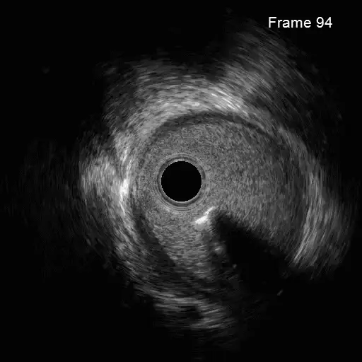
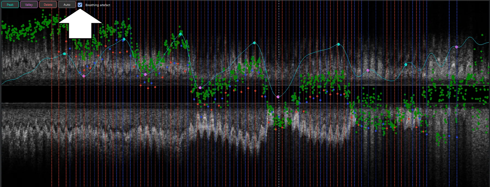
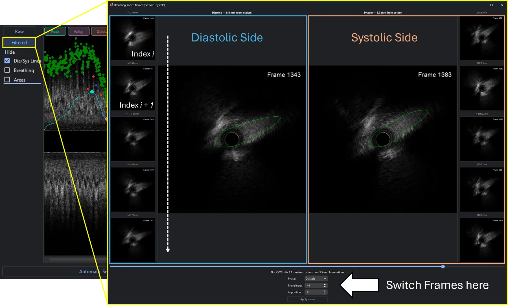

.. docs/contents/modules/breathing.rst

Breathing motion (IVUS)
=======================

*Part of the* :doc:`intravascular` *module, IVUS only.*

There is a second motion artefact which can appear during a pullback. With breathing, the whole
aortic root moves relative to the guiding catheter, which results in much larger movements than
during the cardiac cycle. Pullbacks with large respiratory motion will display wild changes
within the pullback, as in this example:

On the area plot, the breathing artefact appears as a low-frequency oscillation of lumen area,
apart from the labeled systolic and diastolic peaks.

   Longitudinal view after running :doc:`Gating <gating>`. The cyan curve is the extracted
   respiratory envelope, with peaks (maximum displacement) and valleys (rest) marked. However,
   the program does not know whether the oscillation is a real artefact or just noise, so you must 
   declare it with the **Breathing artefact** checkbox.

During a pullback the chest moves. The catheter therefore does not advance along the vessel
at a constant rate: it is alternately held back and pushed forward by respiration, so the
frame number stops being a faithful measure of position. Two frames acquired at the same
distance marker can sit millimetres apart anatomically.

HolOrama detects that respiratory component from the lumen-area signal, lets you decide if it is
a respiratory artefact, review and correct it, and can then **reorder the gated frames into 
a breathing-corrected pullback**.

How it works
------------

1. **Detrend.** A low-order polynomial is fitted to lumen area versus frame number: this is
   the natural taper of the vessel along the pullback. Gated (manually reviewed) frames get
   ten times the weight, so the trend is anchored by reliable points instead of being
   dragged around by ostial noise.
2. **Residual.** ``residual = area − trend``. What remains oscillating is respiration.
3. **Respiratory rate.** Detected as the spectral peak of the residual (or overridden
   manually), then the residual is low-pass filtered at about twice that rate to isolate a
   clean breathing envelope.
4. **Peaks and valleys.** The valleys are found with the beat tracker of the cardiac
   gating, with one breath as the beat: a chain of valleys about one breath apart, which
   also keeps shallow breaths. Each peak is the highest point between two valleys.
   **Valleys are rest**, peaks are maximum respiratory displacement.
5. **Breath profile.** Within each valley-to-valley breath, the envelope above the line
   through its two valleys is scaled to 1 at the peak. A frame's breathing displacement is
   its breath's amplitude times this profile, 0 at rest and largest at the peak.
6. **Shape sort.** The amplitude of every breath is chosen so the lumen area and the
   elliptic ratio change as smoothly as possible along the sorted diastolic and systolic
   stacks: a vessel cannot switch back and forth between round and elliptic, a wrong order
   makes it do so. Diastole and systole share the amplitudes, and all breaths shift in one
   direction (distal or proximal, whichever fits the pullback better).
7. **Fine-tuning and clean-up.** Single frames are then moved a short way (up to half a
   breath) where that makes the stack smoother, and the few frames that still stand out
   from both neighbours, such as a round contour inside the elliptic segment, are moved to
   wherever in the stack they fit best.
8. **Corrected order.** Sorting by the corrected position gives the breathing-corrected
   order used by the *Filtered* view and by the 3D reconstruction.

In ostial pullbacks of anomalous arteries the displacement can reach several millimetres per
breath, more than the pullback advances in one breath, so frames of consecutive breaths
interleave along the vessel. The full method is written up in
``research/gating_validation/paper/breathing_correction.tex``.

Tutorial
--------

Prerequisites
~~~~~~~~~~~~~

- An IVUS pullback with lumen contours: the breathing signal is derived from lumen area,
  and at least 30 contoured frames are needed before the curve is drawn at all.
- :doc:`Gating <gating>` has been run, if you want to use the breathing-corrected sort
  (which reorders *gated* frames).

1. Look at the breathing curve
~~~~~~~~~~~~~~~~~~~~~~~~~~~~~~

The curve is overlaid on the **longitudinal view** in the lower right of the window,
together with the lumen-area dots:

- **Cyan curve**: the extracted respiratory envelope.
- **Cyan markers**: peaks (maximum displacement).
- **Magenta markers**: valleys (rest).

If the oscillation is small relative to the vessel calibre, no markers are drawn: there is
nothing to correct.

Use the *Hide* checkboxes to the left of the longitudinal view to declutter: *Breathing*
clears the curve and its markers, *Areas* clears the area dots, *Dia/Sys Lines* clears the
phase markers.

2. Correct the peaks and valleys
~~~~~~~~~~~~~~~~~~~~~~~~~~~~~~~~

Four small buttons sit on the longitudinal view:

.. list-table::
   :header-rows: 1
   :widths: 20 80

   * - Button
     - Effect
   * - **Peak**
     - Click in the view to add a peak marker.
   * - **Valley**
     - Click in the view to add a valley marker.
   * - **Delete**
     - Click a marker to remove it.
   * - **Auto**
     - Discard all manual edits and return to the automatic detection.

The three mode buttons are mutually exclusive. As soon as you make the first manual edit,
the marker set becomes fully manual, seeded from the automatic guess, so nothing is lost,
but every marker is now deletable.

3. Declare whether there is an artefact at all
~~~~~~~~~~~~~~~~~~~~~~~~~~~~~~~~~~~~~~~~~~~~~~

The **Breathing artefact** checkbox next to those buttons is the switch that decides what
*Filtered* actually does:

- **Checked (default)**: the pullback has a respiratory artefact. The curve is drawn
  solid, and the *Filtered* view applies the breathing correction.
- **Unchecked**: no meaningful artefact. The curve is drawn dotted, and *Filtered* only
  lets you shuffle frames by hand, applying no correction.

Uncheck it when the curve is clearly noise. Forcing a correction onto a pullback without a
real respiratory component only adds error.

4. Review the corrected order
~~~~~~~~~~~~~~~~~~~~~~~~~~~~~

Click **Filtered** (left of the longitudinal view) to open the breathing-sorted viewer. It
runs the shape sort on the gated diastolic and systolic frames together (about a second) and
shows them side by side:

- A central slider scrolls through the **breathing-corrected order**, not acquisition
  order.
- Diastole and systole are shown with their lumen contours, each flanked by a five-image
  filmstrip of its neighbours in sorted order, labelled with index and distance from the
  ostium.
- Only gated frames appear; positions without a frame are skipped.

Look for a frame whose contour is obviously out of sequence with its neighbours; that is
what the manual move is for.

5. Fix individual outliers
~~~~~~~~~~~~~~~~~~~~~~~~~~

At the bottom of the viewer, choose the phase (**Diastole** / **Systole**), enter the index
of the frame and the index it should move to, and click **Apply move**. The other frames keep
their order, and the move is stored immediately.
This sorting can of course also be performed when no breathing artefact is present, but the
patient maybe moved, or other influences resulted in a shift in frames.

Click **Raw** to go back to acquisition order at any time. The sort (peaks, valleys,
ordered indices, per-breath amplitudes and every manual move) is cached with the case and
written into the contour JSON, so it survives closing and reopening. It is only recomputed
when the peaks or valleys change. When the gated frame set changes, newly gated frames are
inserted at their corrected position and the rest of the order, including manual moves, is
kept.

   Example when opening the filtered view. On the left side are all diastolic frames,
   the frames are sorted top to bottom, with the more proximal ones being at the bottom.
   The slider below shows the diastolic and systolic frames registered by the most proximal
   frame (here the ostium). Below frames can be switched by index, the current index is
   always corresponding to the currently displayed frame.

6. Export
~~~~~~~~~

Saving a report always writes ``combined_sorted_manual.csv`` next to the other CSVs: the
gated diastolic frames followed by the systolic frames, in the breathing-corrected order
including manual moves. The contour CSVs follow the same order, so the 3D reconstruction in
the Fusion module stacks the frames as sorted. See :doc:`../outputs`.

Tuning
------

.. list-table::
   :header-rows: 1
   :widths: 30 70

   * - Setting
     - Effect
   * - **Peak** / **Valley**
     - The sort shifts each valley-to-valley breath as a whole, so a missed or extra valley
       matters most. Fix the valleys first if the sorted stack looks wrong in one stretch.
   * - **Breathing sweep** (gating plot)
     - Heat map of the signal filtered at increasing breathing-rate cutoffs; click a row to
       override the detected respiratory rate when the automatic estimate is wrong.

Troubleshooting
---------------

.. list-table::
   :header-rows: 1
   :widths: 38 62

   * - Symptom
     - What to try
   * - No breathing curve is drawn
     - Fewer than 30 contoured frames, or the oscillation is under 5 % of the maximum
       area: there is nothing to correct.
   * - The curve follows the vessel taper rather than respiration
     - The polynomial trend did not capture the taper. Contour more frames, especially
       gated ones, since they carry ten times the weight.
   * - Markers alternate implausibly fast
     - Override the respiratory rate via **Breathing sweep**, or place peaks and valleys by
       hand with the **Peak** / **Valley** buttons.
   * - *Filtered* changes nothing
     - **Breathing artefact** is unchecked, or gating has not been run: the sort operates
       on gated frames.
