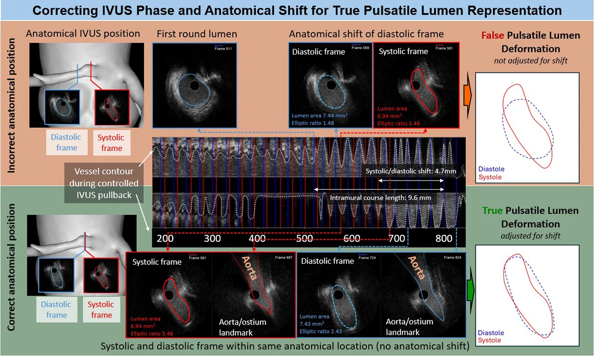
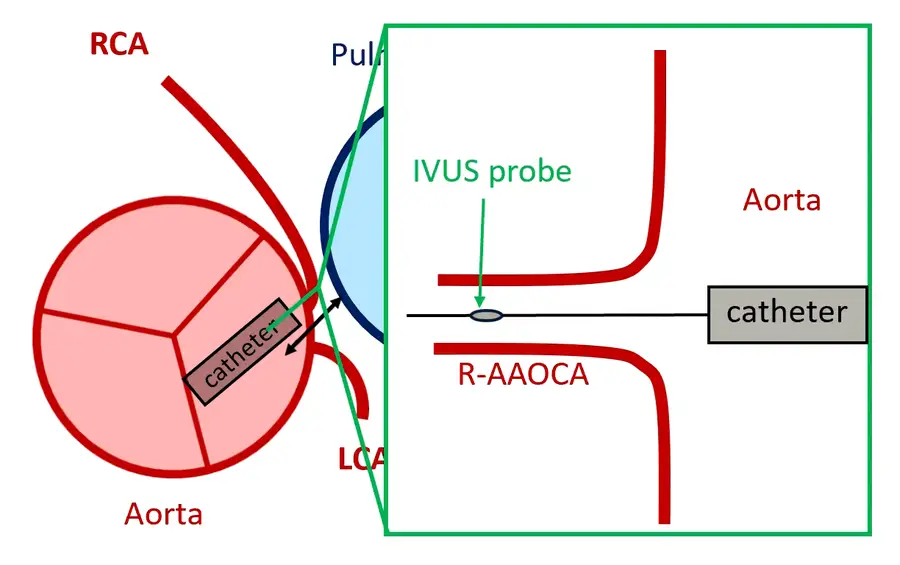
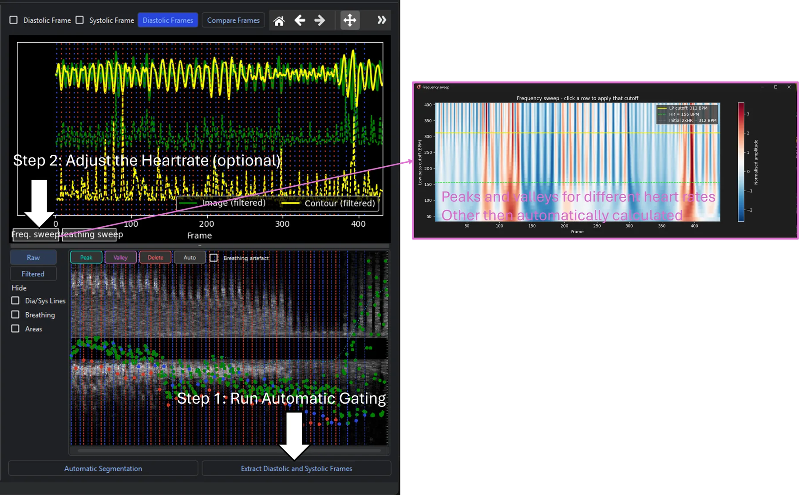
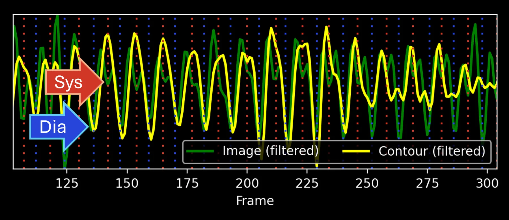

.. docs/contents/modules/gating.rst

Gating (IVUS)
=============

*Part of the* :doc:`intravascular` *module (IVUS only).*

An IVUS pullback is acquired continuously while the heart beats, so consecutive frames
alternate between a relaxed (diastolic) and a compressed (systolic) vessel. Comparing
measurements only makes sense within one phase, which matters most when comparing
measurements between different phases: apparent differences can simply reflect the
relative motion of reference points (e.g., the ostium) during the heartbeat, as we have
previously shown:

   :ref:`Stark et al. 2025 <gating-citation-1>`

This shift, which we described previously, can be attributed to the fact that the vessel
moves relative to the catheter with every heartbeat. This is also demonstrated in the
idealized example below:

HolOrama identifies the phases **from the images themselves** (image-based gating). The
method builds on the
algorithm published as *AIVUS-CAA* (:ref:`Stark et al. 2025 <gating-citation-2>`) and has
been improved and validated against manually gated pullbacks since then.

How it works
------------

Two independent signals are extracted along the pullback and bandpass-filtered around the
detected heart rate.

.. list-table::
   :header-rows: 1
   :widths: 22 78

   * - Signal
     - Definition
   * - **Image** (green)
     - ``s[n] = 1 − NCC(frame_n, frame_n+1)``: one minus the normalised cross-correlation
       of consecutive frames, computed on a central crop so that the burnt-in frame number
       does not contribute. Always available, even before a single contour is drawn. Its
       peaks are the **maximum-motion** frames, timing landmarks rather than stable phase
       points.
   * - **Contour** (yellow)
     - The lumen area per frame, in mm², taken from the report data. Requires contours on
       at least 50 % of the frames. It follows the cardiac cycle, but where diastole falls
       on it differs between patients and vessel segments (pronounced vessel motion near
       the ostium in coronary anomalies, plaque in coronary artery disease). It is shown for
       reference and not used by the automatic gating.

.. rubric:: Heart-rate detection

The cardiac frequency is estimated from the spectrum of the correlation signal inside the
configured search range (``gating.f_cardiac_min`` / ``f_cardiac_max``, default
0.75–3.33 Hz ≈ 45–200 bpm). Because the image signal shows two motion events per beat,
its strongest spectral peak is often the second or third harmonic. HolOrama therefore
sums the power at each candidate frequency and its first harmonics and picks the
candidate with the largest sum, which recovers the true rate for resting and stress
acquisitions alike. The range is intentionally left wide because measurements under
maximal stress are often required for coronary artery anomalies; see the
:ref:`gating-tutorial` section below for how to filter the signal.

.. rubric:: Filtering

Both signals are bandpass-filtered (Butterworth, zero-phase) at
``[bandpass_lo_frac, bandpass_hi_frac] × f_heart``, by default 0.7 to 2.2 × the heart
rate. The lower cutoff removes the slow pullback trend, the upper one removes speckle
noise while keeping the second harmonic.

.. rubric:: Phase assignment

Each heartbeat leaves two valleys in the filtered image signal, one per still phase. The
heart rests longest in diastole, so the **deeper valley is diastole** and the shallower
one systole.

- **Diastole**: a beat tracker chooses the whole chain of diastoles at once among all
  valleys. It prefers deep valleys and steps of about one beat that change only gradually
  along the pullback, so it does not slip onto the systolic valley for a few beats.
- **Systole**: one valley per beat, close to the typical delay after diastole in this
  pullback and at least about a third of a beat away from both neighbouring diastoles.
- **Skipped beats**: a step of about two beats is allowed at a cost, for example around
  an extrasystole or where no clear valley exists. These beats get no gated frames and are
  shaded orange in the gating plot for review.

The result never contains two diastoles closer than 0.7 beat or a diastole directly next
to a systole.

.. note::
   Compared with the original publication, the blur signal, the centroid-vector signal and
   the weight optimisation were removed: on real IVUS data they added noise to an otherwise
   clean correlation signal. The centroid vector in particular is dominated by catheter
   rotation (SNR 0.04, versus 1.54 for lumen area). Combining the correlation signal with a
   blur signal (Maso Talou et al.) and comparing frames one beat apart were evaluated
   against manually gated pullbacks and did not improve the result.

.. _gating-tutorial:

Tutorial
--------

Prerequisites
~~~~~~~~~~~~~

- An IVUS pullback loaded in the :doc:`intravascular` module.
- Optional: lumen contours on at least half the frames (draw them or run **Automatic
  Segmentation**) to show the lumen-area curve for reference. The automatic gating uses
  the image signal only.

See overview of the gating module in the GUI representation below:

   Bottom right: the ``Extract Diastolic and Systolic Frames`` button. Top: the calculated
   image and contour signals (filtered, with the unfiltered image signal below) and the detected gated
   frames (blue = diastole, red = systole, grey = untyped). Below the plot: the
   frequency-sweep and breathing-sweep diagnostic views. Frequency sweep: a heat map of the
   image signal low-pass filtered at increasing BPM cutoffs; the yellow line marks the
   active cutoff based on the automatically detected heart rate (starting at 2 × the
   detected heart rate), and clicking a row applies that cutoff to the main plot. Always
   double-check the automatic estimate. For actual signal interpretation, see below.

1. Run the gating
~~~~~~~~~~~~~~~~~

Click **Extract Diastolic and Systolic Frames** (bottom right), or use
**Run → Extract Diastolic and Systolic Frames**.

A dialog asks for the **lower** and **upper frame limit**. Restrict this to the part of the
pullback you actually want to analyse: excluding the run-in and any segment where the
catheter is not moving cleanly gives a better heart-rate estimate.

2. Read the plot
~~~~~~~~~~~~~~~~

The gating plot appears in the top right of the window:

- **Solid green**: the filtered image signal.
- **Solid yellow**: the filtered contour (lumen-area) signal.
- **Dashed green** curve below them: the image signal unfiltered, for reference.
- **Vertical lines**: the gated frames. Blue = diastole, red = systole, grey = untyped.
- **Orange shaded areas**: beats the automatic gating skipped (possible extrasystole or
  unclear signal). Check these frames and add lines by hand if needed.

If no gated frames exist yet, an automatic estimate is placed for you as soon as the plot
opens. If gating results already exist, they are drawn instead and left untouched.

   Zoomed in on the filtered curves. Green is the image signal, and yellow is the contour signal.
   This illustrates the alternating valleys for diastole and systole in the image signal: the
   diastolic valley is lower, reflecting the minimal motion of the vessel, while the systolic
   valley is shallower, as this effect is less pronounced. The contour signal, on the other
   hand, shows alternating peaks and troughs; here, in a coronary artery anomaly during stress,
   this pattern is more representative of the large vessel shifts inside and outside of the
   intramural course.

3. Correct the result
~~~~~~~~~~~~~~~~~~~~~

The plot is interactive:

- **Click** anywhere on the plot to add a marker line at that frame; the image display
  jumps to it so you can check the frame immediately.
- **Click near an existing line** to select it (it turns dashed), then **drag** it to a
  neighbouring frame.
- **Drag a line downward, out of the axes**, to remove it.
- Use the matplotlib toolbar above the plot to zoom and pan. While a toolbar tool is
  active, clicking does not create markers.
- **Compare Frames** opens a small second display showing the nearest frame of the selected
  phase, the quickest way to confirm that two frames really are in the same phase.

Two diagnostic views sit in the bottom-left corner of the plot:

- **Freq. sweep**: a heat map of the image signal low-pass filtered at increasing BPM
  cutoffs. The yellow line marks the active cutoff (starting at 2 × the detected heart
  rate); click a row to apply that cutoff to the main plot. Use it when the automatic heart
  rate looks wrong. The clicked cutoff implies a heart rate of half its value. If the
  gating is still the unedited automatic result, it is redone at that heart rate
  immediately; if you have edited lines by hand, you are asked once per sweep window
  before they are overwritten. The chosen cutoff is saved with the project.
- **Breathing sweep**: the same idea for the breathing frequency, see :doc:`breathing`.

4. Fix phases in bulk
~~~~~~~~~~~~~~~~~~~~~

- :kbd:`Alt+Delete`: choose a frame range and remove all gating within it.
- :kbd:`Alt+S`: choose a frame range and swap systole and diastole within it. Useful when
  the automatic assignment is systematically inverted over one segment.
- **Edit → Reset Phases** clears everything and starts over.

Individual frames can always be re-tagged with the *Diastolic Frame* / *Systolic Frame*
checkboxes.

5. Work with the gated frames
~~~~~~~~~~~~~~~~~~~~~~~~~~~~~

- The **Diastolic Frames** / **Systolic Frames** toggle decides which phase :kbd:`W` and
  :kbd:`S` traverse.
- :kbd:`Shift+W` / :kbd:`Shift+S` copy the active contour from the next/previous gated
  frame; contouring a gated series is mostly copy-and-adjust.
- :kbd:`Alt+P` plots the results for the gated frames (area difference between systole and
  diastole over the pullback distance).
- **File → Save NIfTis → Gated Frames** exports only the gated frames.

The gated frames are also what the :doc:`fusion` module consumes: the report writes
``diastolic_contours.csv`` and ``systolic_contours.csv``, which become the diastolic and
systolic geometries there.

6. Keyboard shortcuts
~~~~~~~~~~~~~~~~~~~~~

- :kbd:`W` / :kbd:`S`: jump to the next/previous gated frame, in whichever phase the
  **Diastolic Frames** / **Systolic Frames** toggle currently selects.
- :kbd:`Shift+W` / :kbd:`Shift+S`: copy the active contour from the next/previous gated
  frame.
- :kbd:`Alt+P`: plot the results for the gated frames (area difference between systole and
  diastole over the pullback distance).
- :kbd:`Alt+Delete`: choose a frame range and remove all gating within it.
- :kbd:`Alt+S`: choose a frame range and swap systole and diastole within it.

See :doc:`../shortcuts` for the full keyboard and mouse reference.

Troubleshooting
---------------

.. list-table::
   :header-rows: 1
   :widths: 38 62

   * - Symptom
     - What to try
   * - The yellow curve is flat
     - Fewer than 50 % of frames have contours. Draw more, or run **Automatic
       Segmentation** first. The automatic gating does not need it.
   * - Markers are placed at roughly double or half the true rate
     - The heart-rate estimate is off. Open **Freq. sweep** and pick a better cutoff, or
       narrow ``f_cardiac_min`` / ``f_cardiac_max`` in ``config.yaml``.
   * - Diastole and systole are swapped over part of the pullback
     - Select that range with :kbd:`Alt+S`. This can happen at higher heart rates, where
       the two still phases look alike.
   * - Orange shaded beats
     - The automatic gating skipped these beats. Check the frames and place the lines by
       hand if the beat is regular.
   * - Markers are noisy in one segment
     - Re-run the gating with a frame range restricted to the clean segment, or correct the
       lines by hand.

References
----------

.. _gating-citation-1:

1. Stark, A. W., Bigler, M. R., Räber, L., Gräni, C. (2025). *True pulsatile lumen
   visualization in coronary artery anomalies using controlled transducer pullback and
   automated IVUS segmentation.* JACC: Case Reports, 30(22), 104741.
   `doi:10.1016/j.jaccas.2025.104741 <https://doi.org/10.1016/j.jaccas.2025.104741>`_

.. _gating-citation-2:

2. Stark, A. W., Kazaj, P. M., Balzer, S., Ilic, M., Bergamin, M., Kakizaki, R.,
   Giannopoulos, A., Haeberlin, A., Räber, L., Gräni, C. (2025). *Automated intravascular
   ultrasound image processing and quantification of coronary artery anomalies: the HolOrama
   software.* Computer Methods and Programs in Biomedicine, 109065.
   `doi:10.1016/j.cmpb.2025.109065 <https://doi.org/10.1016/j.cmpb.2025.109065>`_
